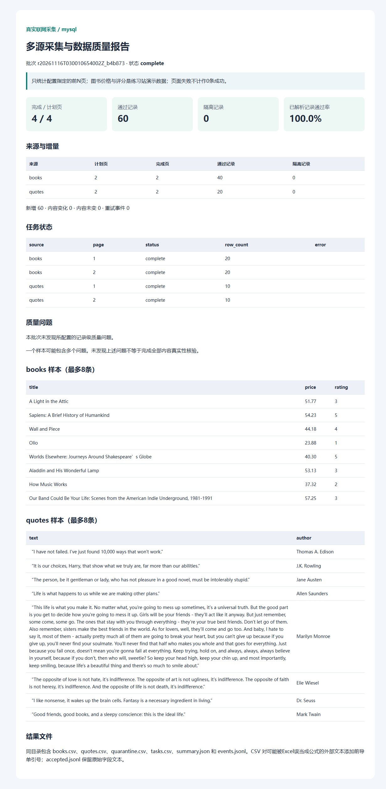

# 多源采集与数据质量监控

面向 Python 爬虫实习的单机项目：静态图书页面 + JavaScript 语录页面，包含质量检查、增量入库、批次记录、失败重试、断点续采和本地报告。

## 已验证的第一版

- 真实联网访问两个官方练习站的前2页：图书40条、动态语录20条，MySQL 8.4实际入库成功。
- MySQL重复运行观察60条、新增0条；模拟8条数据时6条通过、2条隔离。
- 31项离线自动化测试通过，另有MySQL增删改查、内容版本和事务回滚验收。



示例结果见 [examples/live_mysql](examples/live_mysql)，验收依据见 [VERIFICATION.md](VERIFICATION.md)，GitHub参考及设计取舍见 [REFERENCES.md](REFERENCES.md)。采集目标是公开练习沙盒，有限页数的结果不代表生产环境全站采集。

## 在当前电脑上使用

这台电脑已准备独立 Python 环境。双击：

| 文件 | 操作 |
|---|---|
| `01_启动离线演示.cmd` | 无需联网，用6条明确标注的模拟数据走通全流程 |
| `02_启动真实采集.cmd` | 联网采集图书前2页、动态语录前2页，生成新报告 |
| `03_模拟异常隔离.cmd` | 注入空标题、非法价格/评分、重复记录，验证隔离 |
| `04_MySQL真实采集.cmd` | 使用本机独立测试 MySQL 实例；需要 local_config.json |

浏览器打开报告后，先看“模式、数据库、批次状态”，再看完成页数与数据量。`complete` 才表示本轮所有计划页成功且无隔离数据；`partial` 代表有页面失败或记录被隔离，不能包装成全部成功。

首次运行可能需要加载依赖和启动无头浏览器。CMD窗口的退出码：0=完成，1=部分完成/失败，2=启动或配置错误，130=主动暂停/中断。

如果换电脑或只拿到ZIP：先安装 Python 3.12，运行 `setup.cmd`。真实采集另需 Edge 或 Chrome。离线演示不启动浏览器。

## 做了什么

1. requests 获取图书 HTML，lxml/XPath 提取标题、价格、币种、评分、库存文案和链接。
2. DrissionPage 启动独立无头 Chromium，等待语录节点出现；BeautifulSoup 提取文本、作者、标签。不会连接日常登录使用的浏览器。
3. 校验必填字段、正价格、合法评分、来源域名和本批次重复项。隔离记录保留原字段及问题原因。
4. SQLAlchemy 使用同一套表支持 SQLite 和 MySQL。来源+稳定编号决定业务主键；内容哈希区分新增、变化和未变化。
5. 业务记录、观察记录、隔离记录与页面检查点在同一事务提交，续采跳过已完成页面。
6. 保存 HTML 快照、事件日志、CSV、原始字段JSONL和可直接打开的HTML报告。

图书按来源URL识别；语录按“标准化文本+作者”识别。语录改了正文会视为新条目，因此不声称能追踪同一语录的所有正文修订。图书未出现在某次有限采集中不会自动删除。

## 结果在哪里

每次运行生成新的 `runs/批次编号/`：

- `report.html`：先看这个。
- `summary.json`：本批次模式、范围、数量、状态和质量指标。
- `books.csv` / `quotes.csv`：本批次通过记录。
- `quarantine.csv`：原始问题记录与问题类型。
- `tasks.csv`：页面任务完成/失败情况。
- `events.jsonl`：逐事件记录，含重试原因。
- `snapshots/`：采集时的页面或渲染后DOM。

数据库在 `data/crawler.sqlite`；MySQL模式写到配置指定的数据库。SQLite和MySQL是两种独立后端，不会把一方的结果称作另一方。模拟/联网记录在数据库内按模式隔离。

CSV包含UTF-8 BOM。外部文本如以公式触发字符开头，导出CSV时添加前导单引号；`accepted.jsonl`和数据库中仍保留原字段。网页快照用于排查，不代表任何网站全部内容已采集。

## 命令行与断点续采

在项目目录使用所选环境的Python：

```powershell
python run_project.py --mode demo
python run_project.py --mode live --book-pages 2 --quote-pages 2
python run_project.py --mode demo --fault dirty
python run_project.py --mode demo --fault selector
python run_project.py --mode demo --fault timeout
python run_project.py --mode demo --stop-after-pages 1
python run_project.py --resume 控制台打印的批次编号
```

MySQL批次续采需加 `--backend mysql`。`--resume`使用该批次原配置，不重新解释页数或故障设置。已隔离的记录不会因续采自动变好；修正数据或规则后应新开批次。页面解析失败可在修正解析器后续采。

联网任务默认每来源请求间隔至少1秒；检查robots规则；仅对超时、连接失败及429/部分5xx有限重试。服务器要求等待超过30秒时本轮停止，不缩短等待。404、拒绝访问和选择器失效不当作成功。

仅支持同一项目一个运行进程；文件锁避免误开两个实例。未实现多机队列、分布式爬虫、验证码绕过或登录账号采集。动态浏览器会加载页面必要资源，日志的fetch_attempt不是全部网络请求量。失败页没有可计算的记录通过率，不能用质量通过率替代任务成功率。

## MySQL

项目不要求修改系统服务。当前电脑的本地测试配置保存在 `local_config.json`（不打进源码ZIP）；验证实例仅绑定127.0.0.1，端口与常见3306分开。启动脚本可按配置启动该独立实例。

换电脑时，在自己的MySQL中建立数据库和只对该库有权限的账号，复制 `local_config.example.json` 为 `local_config.json` 并填写连接。密码含特殊字符时需URL编码。也可使用 `CRAWLER_DATABASE_URL` 环境变量；本项目不会自动回退并宣称MySQL成功。

业务表：`cq_runs` 批次；`cq_tasks` 页面检查点；`cq_records` 当前业务记录；`cq_versions` 内容版本；`cq_observations` 每批次观察；`cq_quarantine` 隔离项；`cq_events` 事件。

练习查询见 `sql/practice.sql`。本项目已有SQLite SQL基础不能替代MySQL实测，具体实测结论见 `VERIFICATION.md`。

## 测试与学习

```powershell
python -m pip install -r requirements-dev.txt
python -m pytest -q
```

离线测试不访问真实网站，验证解析失败、非法字段、跨页重复、内容更新版本、事务回滚、重试边界、断点续采和报告数量守恒。模拟超时不意味着真实网站发生过超时。

先读 `run_project.py` 的 execute 流程，再读 parsers.py、storage.py、fetchers.py。先理解一条数据从页面到数据库的路径，不需要一次记住全部代码。

## 数据来源与参考

两个采集目标均为官方爬虫练习沙盒：https://sites.toscrape.com/ 。图书价格、评分是演示值，不能解释为真实市场数据。第三方引用文本保留来源，不因本项目代码许可证而取得新的内容许可。

GitHub设计参考、文件版本及取舍见 `REFERENCES.md`。本项目使用AI辅助开发，当前交付不等于用户已独立编写或掌握所有模块；适合在亲自复现、理解与修改后据实描述贡献。
